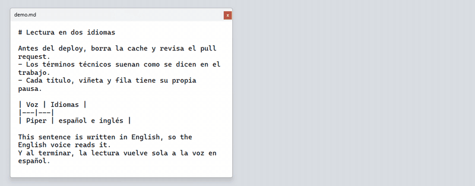
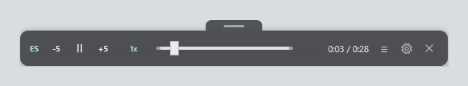
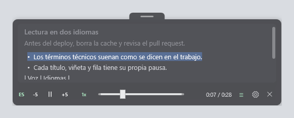
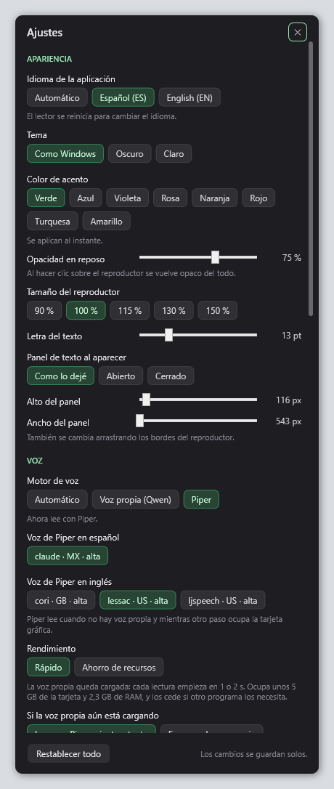
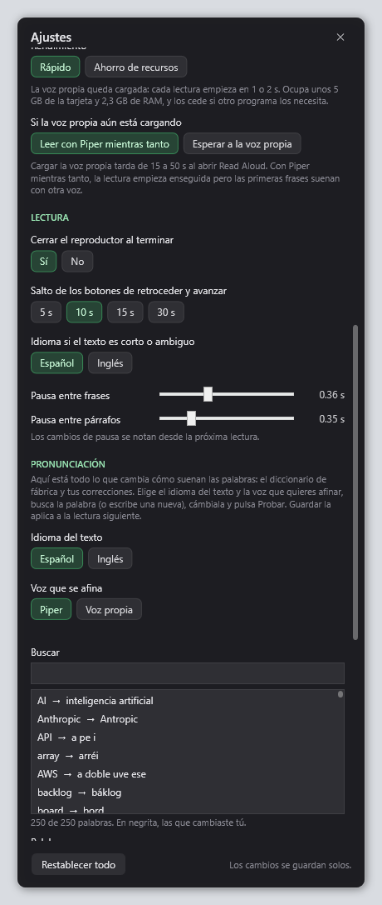
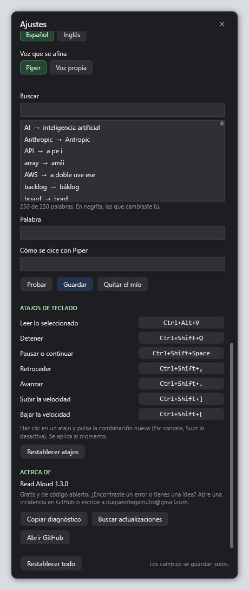
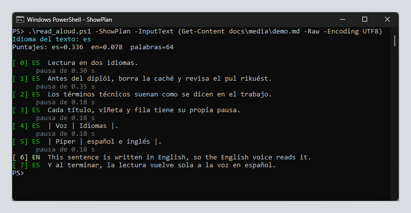

# Read Aloud

[](https://github.com/DuqueOM/read_aloud/actions/workflows/ci.yml)

[English](README.md) · Español

<p align="center">
  
</p>

La misma demostración en un video de 34 segundos con sonido: los términos
técnicos en español y el cambio a la voz en inglés y de vuelta
([descárgalo](docs/media/demo.mp4)).

https://github.com/user-attachments/assets/59986ab1-2789-42c1-a016-11651bd9fa13

Lee en voz alta el texto que tengas seleccionado, con un atajo de teclado y
voces neuronales que corren en tu propia máquina. Sin internet, sin cuentas y
sin enviar nada a ningún servidor.

Está pensado para leer mientras trabajas: distingue el español del inglés
dentro de un mismo texto y pronuncia los términos técnicos como los dirías tú,
no como los leería un lector que no sabe inglés.

```
Ctrl+Alt+V          leer lo que esté seleccionado
Ctrl+Shift+Q        detener
Ctrl+Shift+Espacio  pausar o continuar
Ctrl+Shift+,        retroceder 10 segundos
Ctrl+Shift+.        avanzar 10 segundos
Ctrl+Shift+] y [    subir o bajar la velocidad
```

Read Aloud deja un icono en la bandeja del sistema, junto al reloj: muestra
que está activo, abre los ajustes y "Salir de Read Aloud" lo cierra del todo.
Cada atajo se cambia desde los ajustes (haz clic en él y pulsa la combinación
nueva).

Mientras lee aparece una barra pequeña sobre todas las ventanas, con pausa,
avance, retroceso, velocidad y posición. Se cierra sola al terminar.



El botón `≡` de esa barra despliega el texto que se está leyendo, con la frase
que suena resaltada y lo ya leído atenuado. Así no te pierdes aunque cambies
de ventana. Un clic sobre una frase salta a ella, y el texto se puede
seleccionar y copiar con el clic derecho. Con el texto abierto, la ventana
cambia de tamaño desde cualquiera de sus lados y esquinas. Se mueve con la
pestaña de arriba.



El botón de la tuerca (o el acceso directo del escritorio que puede crear el
instalador) abre los ajustes. Todo se aplica al instante, sin reiniciar: el
idioma, el tema y el color de acento, la opacidad, el tamaño y la letra; la
voz, el motor y el rendimiento; las pausas; los atajos de teclado; y un
diccionario de pronunciación donde puedes buscar cualquier palabra, cambiar
cómo se dice en cada idioma y con cada voz, y probarla. Ver
[docs/configuracion.md](docs/configuracion.md#panel-de-ajustes).

<p align="center">
  
  
  
</p>

## Qué tiene por dentro

- **Un proceso residente en vez de un script por atajo.** El atajo no arranca
  PowerShell: escribe en la tubería con nombre de un proceso que mantiene un
  `piper.exe` por idioma con su modelo ya cargado. La orden se acepta en 20 a
  80 ms y la primera frase se sintetiza en 60 a 200 ms; antes, solo arrancar
  PowerShell tardaba de 400 a 800 ms, y el modelo se volvía a cargar en cada
  fragmento.
- **Lectura frase a frase.** Cada fragmento es una frase: la primera suena en
  cuanto está lista mientras se generan las siguientes, y el panel resalta
  justo lo que se oye.
- **Pausas según la estructura.** Antes de partirlo, el texto se lee como lo
  que es (títulos, párrafos, filas de tabla, viñetas), y cada tipo de bloque
  tiene su pausa.
- **Idioma por frase, palabras por diccionario.** Cada frase elige su idioma
  por sus palabras funcionales, su ortografía y su morfología, con puntajes
  normalizados por longitud para poder comparar una frase corta con un
  párrafo largo. Una palabra suelta en inglés no cambia la voz: un diccionario
  de 250 términos la reescribe con ortografía española.
- **Una voz propia, opcional.** Un proceso que saca la voz de una persona de
  grabaciones donde hablan varias, limpia y transcribe el audio y afina
  [Qwen3-TTS](https://github.com/QwenLM/Qwen3-TTS) con LoRA, corrigiendo tres
  errores de la receta oficial. Para leer en tiempo real en una tarjeta de
  8 GB, las capas LoRA se funden en los pesos, los 15 pasos del predictor
  chico de códigos se repiten como un CUDA graph y las frases se generan en
  grupo. La generación pasa de 3.76 a 0.34 veces lo que dura el audio, con
  las predicciones comprobadas contra la librería.
- **Decisiones por escrito.** Cada decisión importante es un
  [ADR](docs/adr/README.md) con sus medidas y las alternativas descartadas.

## Qué necesitas

| Requisito | Detalle |
|---|---|
| Windows | 10 u 11, 64 bits |
| Windows PowerShell | 5.1, el que ya viene con Windows |
| Espacio en disco | Unos 210 MB para el motor y dos voces |
| Tarjeta NVIDIA de 7 GB o más | Solo para la voz propia, que es opcional |

No hace falta ser administrador. Nada se instala fuera de la carpeta del
repositorio y de tu carpeta de Inicio.

## Instalación

**La forma fácil (no hace falta saber programar).** Descarga
`ReadAloud-Setup-<versión>.exe` del
[último release](https://github.com/DuqueOM/read_aloud/releases/latest), ábrelo
y sigue el asistente. Se instala solo para tu usuario (sin permisos de
administrador), descarga las voces (unos 200 MB, una sola vez) y, si dejas
marcada la casilla, abre Read Aloud cada vez que inicias sesión. Después,
selecciona cualquier texto y pulsa `Ctrl+Alt+V`.

El instalador no está firmado (un certificado cuesta dinero cada año), así que
la primera vez Windows SmartScreen puede decir "Windows protegió su PC": pulsa
"Más información" y luego "Ejecutar de todas formas". Junto al instalador hay
un archivo `.sha256` con su suma de comprobación, para verificar que la
descarga está íntegra:

```powershell
(Get-FileHash .\ReadAloud-Setup-1.2.0.exe).Hash
```

El instalador puede dejar un acceso directo en el escritorio que abre los
ajustes (sin leer nada), y el menú Inicio trae "Ajustes de Read Aloud",
"Cerrar Read Aloud", "Instalar o reparar las voces" y "Desinstalar Read Aloud"
(también en "Aplicaciones" de la Configuración de Windows; pregunta si quieres
conservar tus ajustes y tu diccionario).

El instalador descarga el motor de voz y las voces (unos 200 MB). Si falla
(sin internet, un firewall o un antivirus de por medio), te lo dice, y Read
Aloud ofrece descargarlos la primera vez que lo abras; también puedes usar
"Instalar o reparar las voces" del menú Inicio. Lo que pasó queda en
`read_aloud_piper\runtime\setup.log` (lo primero que hay que mandar si pides
ayuda).

**Actualizar.** Instalar una versión nueva sobre la anterior conserva tus
ajustes, tu diccionario de pronunciación, `config/settings.psd1` y
`config/settings.local.psd1`. Los diccionarios de fábrica
(`config/terms_*.tsv`) se reemplazan por los nuevos; los anteriores quedan en
`copia_de_config_anterior`. Read Aloud consulta GitHub una vez al día y, si hay
una versión nueva, muestra un aviso en la bandeja; no instala nada sin que lo
confirmes, no envía ningún dato tuyo y el aviso se apaga en Ajustes > Acerca de.

**Desde el repositorio (para desarrolladores):**

```powershell
git clone https://github.com/DuqueOM/read_aloud.git
cd read_aloud
.\setup.ps1
.\install_startup.ps1
```

`setup.ps1` descarga el motor Piper y los modelos de voz, que no están en el
repositorio porque pesan demasiado para Git. `install_startup.ps1` deja los
atajos y el motor activos cada vez que inicias sesión en Windows.

Si PowerShell se niega a ejecutar los scripts, ábrelos así una sola vez:

```powershell
powershell -ExecutionPolicy Bypass -File .\setup.ps1
```

Comprueba que todo quedó bien:

```powershell
.\read_aloud.ps1 -Diagnose
```

## Cómo se usa

Selecciona texto en cualquier programa y pulsa `Ctrl+Alt+V`. También
funciona desde la consola:

```powershell
.\read_aloud.ps1                                   # lee el portapapeles
.\read_aloud.ps1 -InputText "Hola, buenos dias"    # lee un texto concreto
.\read_aloud.ps1 -Stop                             # detiene
.\read_aloud.ps1 -Toggle                           # pausa o continua
.\read_aloud.ps1 -Language English                 # fuerza el idioma
.\read_aloud.ps1 -ShowPlan                         # muestra la segmentacion, sin leer
.\read_aloud.ps1 -ListVoices                       # voces instaladas
.\read_aloud.ps1 -Diagnose                         # revisa la instalacion
```

`-ShowPlan` es la herramienta para entender por qué una frase sonó en un
idioma y no en otro. Muestra el texto ya partido, con la voz asignada a cada
parte y sin reproducir nada.



## Cómo está armado

```
Ctrl+Alt+V                   read_aloud.ps1
  (proceso residente)          (consola)
        |                          |
        +----------+---------------+
                   |
          tuberia read_aloud_pipe
                   |
        read_aloud_daemon.ps1
        proceso residente
                   |
        +----------+----------+---------------------+
        |                     |                     |
   piper.exe es          piper.exe en        servidor_qwen.py
   (modelo cargado)      (modelo cargado)    (voz propia, opcional)
                   |
        reproductor flotante
```

El proceso residente tiene tres hilos: la tubería, que encola lo que llega;
la síntesis, que le pasa cada fragmento al motor de su idioma; y la interfaz,
con la ventana del reproductor. Un mutex con nombre deja una sola instancia.
En reposo, la síntesis espera un evento en vez de mirar su cola, y el pulso de
la ventana baja de 60 a 250 ms: unos 16 ms de procesador cada 20 s.

Detalle completo en [docs/como-funciona.md](docs/como-funciona.md).

## Idiomas

El texto se divide en frases y cada frase elige su idioma. Las frases
contiguas del mismo idioma se agrupan y se leen con la voz correspondiente,
así que un párrafo en inglés dentro de un texto en español suena en inglés.

Una palabra suelta en inglés no cambia la voz. Cambiar de voz por una sola
palabra suena peor que ajustar la escritura, así que esos términos se
reescriben con ortografía española antes de leerlos: `deploy` se convierte en
`diplói`, `cache` en `caché`, `pull request` en `pul rikuést`.

Ese diccionario es un archivo de texto que puedes editar:
[config/terms_es.tsv](config/terms_es.tsv). Trae 250 términos de programación
y trabajo. Más detalles en [docs/idiomas.md](docs/idiomas.md).

## Ajustes

Lo más común se cambia desde el botón de la tuerca del reproductor. El resto
está en [config/settings.psd1](config/settings.psd1): velocidad, voces, tamaño
de los fragmentos, pausas y segundos de salto. Lo que es de tu equipo, como la
carpeta de la voz propia, va en `config/settings.local.psd1`, que Git ignora.

Nada de lo que cambias en el panel pide reiniciar (solo el idioma de la
interfaz reinicia el lector, solo). Después de editar `settings.psd1` a mano,
cierra el proceso desde la consola, o con "Cerrar Read Aloud" del menú Inicio, y
la próxima lectura lo vuelve a arrancar:

```powershell
. .\lib\ReadAloud.Core.ps1
Send-ReadAloudCommand -PipeName 'read_aloud_pipe' -Command @{ cmd = 'quit' }
```

Referencia de cada valor en [docs/configuracion.md](docs/configuracion.md).

## Si algo falla

Empieza siempre por `.\read_aloud.ps1 -Diagnose`. El registro del proceso
residente está en `read_aloud_piper\runtime\daemon.log`.

Los casos frecuentes y su solución están en
[docs/problemas.md](docs/problemas.md).

## Voz personalizada

Además de las voces de Piper, Read Aloud puede leer con una voz propia
entrenada con [Qwen3-TTS](https://github.com/QwenLM/Qwen3-TTS). Esa voz
necesita una tarjeta NVIDIA de al menos 7 GB y su propia instalación. Con el
ajuste por defecto, `auto`, se usa solo si las dos cosas están; si no, se lee
con Piper como siempre.

- [docs/voz-personalizada.md](docs/voz-personalizada.md) explica, paso a paso,
  cómo sacar una voz de grabaciones donde habla junto a otras, entrenarla y
  usarla en Read Aloud. El código está en `voz_personalizada/`.
- [docs/configuracion.md](docs/configuracion.md#voz-propia-con-qwen3-tts)
  tiene los ajustes de la voz propia.
- [docs/adr/](docs/adr/README.md) reúne las decisiones importantes del proceso
  y por qué se tomaron.

## Desarrollo

La lógica del texto y los ajustes tienen pruebas de [Pester](https://pester.dev),
con planes de lectura de referencia para textos de ejemplo. Corren en Windows
PowerShell 5.1 y en PowerShell 7:

```powershell
powershell -NoProfile -ExecutionPolicy Bypass -File tools\run_pester.ps1
```

[tests/README.md](tests/README.md) explica cómo correrlas y cómo actualizar
los planes de referencia. [pre-commit](https://pre-commit.com) revisa cada
commit con gitleaks, ruff y PSScriptAnalyzer; el CI corre las mismas
revisiones y busca secretos en todo el historial.

## Estructura del repositorio

```
read_aloud.ps1              Punto de entrada
read_aloud_daemon.ps1       Proceso residente y reproductor
lib/ReadAloud.Hotkeys.ps1   Atajos de teclado
stop_read_aloud.ps1         Detener
setup.ps1                   Instala el motor y las voces
install_startup.ps1         Arranque automatico con Windows
config/settings.psd1        Ajustes
config/terms_es.tsv         Diccionario de pronunciacion
lib/ReadAloud.Core.ps1      Rutas, ajustes, audio y comunicacion
lib/ReadAloud.Text.ps1      Idioma, segmentacion y normalizacion
lib/ReadAloud.Settings.ps1  Panel de ajustes
lib/servidor_qwen.py        Proceso de la voz propia (Qwen3-TTS)
lib/qwen_rapido.py          Generacion en tiempo real de Qwen3-TTS
docs/                       Documentacion
docs/adr/                   Registro de decisiones
voz_personalizada/          Proceso para crear una voz propia
tests/                      Pruebas de Pester
tools/                      Revisiones del pre-commit y del CI
read_aloud_piper/           Motor y voces (lo crea setup.ps1)
```

## Apoya el proyecto

Si te sirve la app, apóyame con una estrella en GitHub o compartiendo el
repositorio con alguien que pueda necesitarlo. El código es gratis, pero el
cariño y el tiempo que hay en cada detalle es lo que le da valor a lo que
hacemos, por simple o pequeño que sea.

## Comentarios y contacto

¿Encontraste un error, tienes una idea o una sugerencia? Abre una
[incidencia](https://github.com/DuqueOM/read_aloud/issues) para que otras
personas la vean y la completen, o escríbeme directamente a
[duqueortegamutis@gmail.com](mailto:duqueortegamutis@gmail.com). Leo todo.

## Créditos y licencia

El motor de voz es [Piper](https://github.com/rhasspy/piper), de Rhasspy, con
licencia MIT. Las voces vienen de
[rhasspy/piper-voices](https://huggingface.co/rhasspy/piper-voices) y cada una
tiene su propia licencia, indicada en su ficha.

La voz propia usa [Qwen3-TTS](https://github.com/QwenLM/Qwen3-TTS) y
[Qwen3-ASR](https://github.com/QwenLM/Qwen3-ASR), de Qwen, con licencia
Apache-2.0. Las demás herramientas del proceso están en
[docs/voz-personalizada.md](docs/voz-personalizada.md#herramientas).

Este repositorio contiene únicamente los scripts que orquestan todo eso, con
licencia [Apache 2.0](LICENSE). Las licencias de lo que se descarga al
instalar están en [NOTICE](NOTICE).
