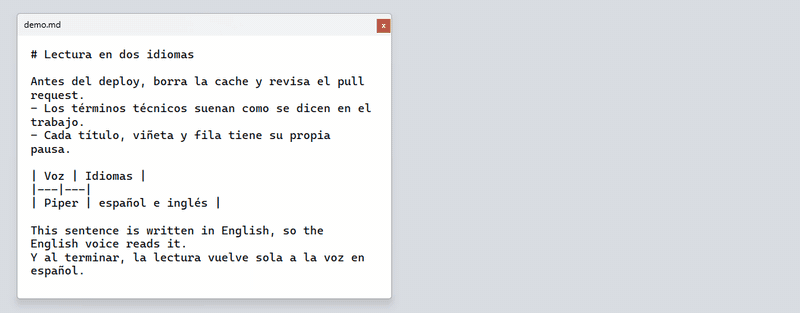
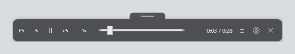
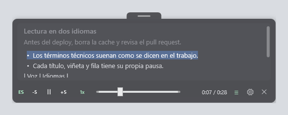
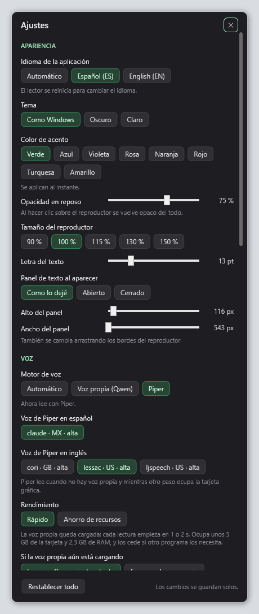
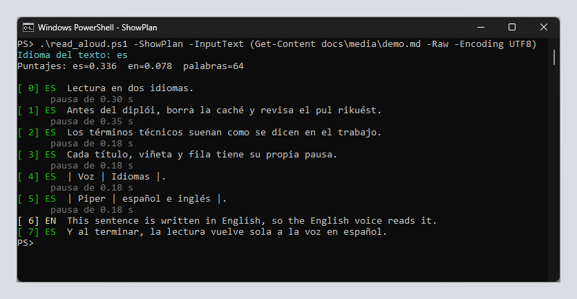

# Read Aloud

[](https://github.com/DuqueOM/read_aloud/actions/workflows/ci.yml)

English · [Español](README.es.md)

<p align="center">
  
</p>

The same demo as a 34-second video with sound: the technical terms in
Spanish and the switch to the English voice and back
([download it](docs/media/demo.mp4)).

https://github.com/user-attachments/assets/59986ab1-2789-42c1-a016-11651bd9fa13

Reads the selected text aloud with a keyboard shortcut, using neural voices
that run on your own machine. No internet connection, no accounts, and nothing
is sent to any server.

It is built for reading while you work: it tells Spanish from English within
the same text and pronounces technical terms the way you would say them, not
the way a reader that knows no English would.

```
Ctrl+Shift+V        read the selected text
Ctrl+Shift+Q        stop
Ctrl+Shift+Space    pause or resume
Ctrl+Shift+,        back 10 seconds
Ctrl+Shift+.        forward 10 seconds
Ctrl+Shift+] and [  faster or slower
```

While it reads, a small bar stays on top of all windows, with pause, skip,
speed and position. It closes on its own when the reading ends.



The `≡` button on that bar opens the text being read, with the current
sentence highlighted and what was already read dimmed, so you don't lose your
place when you switch windows. Clicking a sentence jumps to it, and the text
can be selected and copied with a right click. With the text open, the window
can be resized from any side or corner, and it moves with the tab on top.



The gear button opens the settings: opacity, size, font, the voice and the
performance mode (the voice always loaded, or loaded only while reading to
save resources). See
[docs/configuracion.md](docs/configuracion.md#panel-de-ajustes) (in Spanish).




The detailed documentation in [docs/](docs/) is in Spanish.

## What's inside

- **A resident process instead of a script per shortcut.** The shortcut does
  not start PowerShell: it writes to a named pipe of a process that keeps one
  `piper.exe` per language with its model already loaded. The command is
  accepted in 20 to 80 ms and the first sentence is synthesized in 60 to
  200 ms; before, starting PowerShell alone took 400 to 800 ms, and the model
  was reloaded for every chunk.
- **Sentence-by-sentence streaming.** Each chunk is one sentence: the first
  one plays as soon as it is ready while the next ones are generated, and the
  panel highlights exactly what you hear.
- **Structure-aware pauses.** Before splitting, the text is read as what it
  is (headings, paragraphs, table rows, bullets), and each kind of block gets
  its own pause.
- **Language per sentence, words by dictionary.** Each sentence picks its
  language with stop words, spelling and morphology, normalized by length so
  a short sentence can be compared with a long paragraph. A single English
  word does not switch the voice: a dictionary of 250 terms rewrites it with
  Spanish spelling.
- **An optional custom voice.** A pipeline that extracts one speaker from
  recordings where several people talk, cleans and transcribes the audio and
  fine-tunes [Qwen3-TTS](https://github.com/QwenLM/Qwen3-TTS) with LoRA,
  fixing three bugs in the official recipe. To read in real time on an 8 GB
  card, the LoRA layers are merged into the weights, the 15 steps of the
  small code predictor are replayed as a CUDA graph and sentences are
  generated in batches. Generation goes from 3.76 to 0.34 times the audio
  length, with predictions checked against the library.
- **Decisions on record.** Each important choice is an
  [ADR](docs/adr/README.md) with its measurements and the alternatives that
  were discarded.

## Requirements

| Requirement | Details |
|---|---|
| Windows | 10 or 11, 64-bit |
| Windows PowerShell | 5.1, the one that comes with Windows |
| AutoHotkey v2 | Only for the keyboard shortcuts. [autohotkey.com](https://www.autohotkey.com) |
| Disk space | About 210 MB for the engine and two voices |
| NVIDIA GPU, 7 GB or more | Only for the optional custom voice |

No administrator rights are needed. Nothing is installed outside the
repository folder and your Startup folder.

## Installation

```powershell
git clone https://github.com/DuqueOM/read_aloud.git
cd read_aloud
.\setup.ps1
.\install_startup.ps1
```

`setup.ps1` downloads the Piper engine and the voice models, which are not in
the repository because they are too large for Git. `install_startup.ps1` keeps
the shortcuts and the engine running every time you sign in to Windows.

If PowerShell refuses to run the scripts, run them this way once:

```powershell
powershell -ExecutionPolicy Bypass -File .\setup.ps1
```

Check that everything is in place:

```powershell
.\read_aloud.ps1 -Diagnose
```

## Usage

Select text in any program and press `Ctrl+Shift+V`. It also works from the
console:

```powershell
.\read_aloud.ps1                                  # read the clipboard
.\read_aloud.ps1 -InputText "Hola, buenos dias"   # read a given text
.\read_aloud.ps1 -Stop                            # stop
.\read_aloud.ps1 -Toggle                          # pause or resume
.\read_aloud.ps1 -Language English                # force the language
.\read_aloud.ps1 -ShowPlan                        # show the segmentation, without reading
.\read_aloud.ps1 -ListVoices                      # installed voices
.\read_aloud.ps1 -Diagnose                        # check the installation
```

`-ShowPlan` is the tool for understanding why a sentence was read in one
language and not the other. It shows the text already split, with the voice
assigned to each part, without playing anything.



## How it is built

```
Ctrl+Shift+V                 read_aloud.ps1
  (AutoHotkey)                 (console)
        |                          |
        +----------+---------------+
                   |
          named pipe read_aloud_pipe
                   |
        read_aloud_daemon.ps1
        resident process
                   |
        +----------+----------+---------------------+
        |                     |                     |
   piper.exe es          piper.exe en        servidor_qwen.py
   (model loaded)        (model loaded)      (custom voice, optional)
                   |
        floating player
```

The resident process has three threads: the pipe, which queues what arrives;
synthesis, which hands each chunk to the engine of its language; and the
interface, with the player window. A named mutex keeps a single instance.
When idle, synthesis waits for an event instead of checking its queue, and
the window timer slows from 60 to 250 ms: about 16 ms of CPU every 20 s.

Details in [docs/como-funciona.md](docs/como-funciona.md).

## Languages

The text is split into sentences and each sentence picks its language.
Adjacent sentences in the same language are grouped and read with that voice,
so an English paragraph inside a Spanish text is read in English.

A single English word does not change the voice. Switching voices for one
word sounds worse than adjusting the spelling, so those terms are rewritten
with Spanish spelling before reading: `deploy` becomes `diplói`, `cache`
becomes `caché`, `pull request` becomes `pul rikuést`.

That dictionary is a text file you can edit:
[config/terms_es.tsv](config/terms_es.tsv). It has 250 programming and work
terms. More in [docs/idiomas.md](docs/idiomas.md).

## Settings

The most common settings are changed from the gear button on the player. The
rest live in [config/settings.psd1](config/settings.psd1): speed, voices,
chunk size, pauses and skip seconds. Settings that belong to your machine, such
as the custom voice folder, go in `config/settings.local.psd1`, which Git
ignores.

Some changes apply only after restarting the resident process. When you make
one in the panel, it offers a "Reiniciar ahora" (restart now) button. After
editing `settings.psd1`, close the process from the console and the next
reading starts it again:

```powershell
. .\lib\ReadAloud.Core.ps1
Send-ReadAloudCommand -PipeName 'read_aloud_pipe' -Command @{ cmd = 'quit' }
```

Every value is described in [docs/configuracion.md](docs/configuracion.md).

## Troubleshooting

Always start with `.\read_aloud.ps1 -Diagnose`. The resident process log is
in `read_aloud_piper\runtime\daemon.log`.

Common problems and their fixes are in [docs/problemas.md](docs/problemas.md).

## Custom voice

Besides the Piper voices, Read Aloud can read with a custom voice trained
with [Qwen3-TTS](https://github.com/QwenLM/Qwen3-TTS). That voice needs an
NVIDIA card with at least 7 GB and its own installation. With the default
setting, `auto`, it is used only if both are there; otherwise Piper reads as
usual.

- [docs/voz-personalizada.md](docs/voz-personalizada.md) explains, step by
  step, how to extract a voice from recordings where it speaks alongside
  others, train it and use it in Read Aloud. The code is in
  `voz_personalizada/`.
- [docs/configuracion.md](docs/configuracion.md#voz-propia-con-qwen3-tts) has
  the custom voice settings.
- [docs/adr/](docs/adr/README.md) collects the important decisions of the
  process and why they were made.

## Development

The text logic and the settings have [Pester](https://pester.dev) tests,
including reference reading plans for sample texts. They run on Windows
PowerShell 5.1 and PowerShell 7:

```powershell
powershell -NoProfile -ExecutionPolicy Bypass -File tools\run_pester.ps1
```

[tests/README.md](tests/README.md) explains how to run them and how to update
the reference plans. [pre-commit](https://pre-commit.com) checks each commit
with gitleaks, ruff and PSScriptAnalyzer; the CI runs the same checks and
scans the whole history for secrets.

## Repository layout

```
read_aloud.ps1              Entry point
read_aloud_daemon.ps1       Resident process and player
read_aloud_hotkey.ahk       Keyboard shortcuts
stop_read_aloud.ps1         Stop
setup.ps1                   Installs the engine and the voices
install_startup.ps1         Starts with Windows
config/settings.psd1        Settings
config/terms_es.tsv         Pronunciation dictionary
lib/ReadAloud.Core.ps1      Paths, settings, audio and communication
lib/ReadAloud.Text.ps1      Language, segmentation and normalization
lib/ReadAloud.Settings.ps1  Settings panel
lib/servidor_qwen.py        Custom voice process (Qwen3-TTS)
lib/qwen_rapido.py          Real-time Qwen3-TTS generation
docs/                       Documentation (Spanish)
docs/adr/                   Decision records
voz_personalizada/          Pipeline to create a custom voice
tests/                      Pester tests
tools/                      Checks for pre-commit and the CI
read_aloud_piper/           Engine and voices (created by setup.ps1)
```

## Support the project

If Read Aloud is useful to you, support it with a star on GitHub or by sharing
the repo with someone who could use it. The code is free, but the love and time
put into every detail is what gives value to what we do, however simple or
small it is.

## Feedback and contact

Found a bug, have an idea or a suggestion? Open an
[issue](https://github.com/DuqueOM/read_aloud/issues) so others can see it and
add to it, or write to me directly at
[duqueortegamutis@gmail.com](mailto:duqueortegamutis@gmail.com). I read
everything.

## Credits and license

The voice engine is [Piper](https://github.com/rhasspy/piper), by Rhasspy,
under the MIT License. The voices come from
[rhasspy/piper-voices](https://huggingface.co/rhasspy/piper-voices) and each
one has its own license, stated on its model card.

The custom voice uses [Qwen3-TTS](https://github.com/QwenLM/Qwen3-TTS) and
[Qwen3-ASR](https://github.com/QwenLM/Qwen3-ASR), by Qwen, under Apache-2.0.
The other tools of the pipeline are listed in
[docs/voz-personalizada.md](docs/voz-personalizada.md#herramientas).

This repository contains only the scripts that orchestrate all of that,
under the [Apache 2.0](LICENSE) license. The licenses of what is downloaded
during installation are in [NOTICE](NOTICE).
